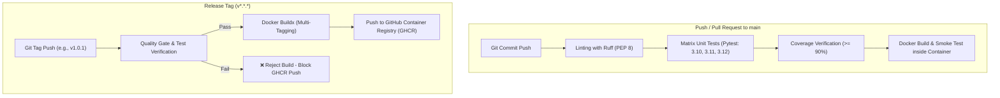

# 🚀 DevOps Log Analyzer CLI

[](https://github.com/duytrancoder/Python_LogAnalyzer/actions/workflows/ci.yml)
[](https://github.com/duytrancoder/Python_LogAnalyzer/actions/workflows/release.yml)
[](https://github.com/duytrancoder/Python_LogAnalyzer/pkgs/container/python_loganalyzer)
[](https://github.com/duytrancoder/Python_LogAnalyzer)
[](https://github.com/duytrancoder/Python_LogAnalyzer)
[](LICENSE)

A cloud-native, production-ready command-line tool built to parse application logs into structured severity metrics, resiliently handle corrupt data dumps without crashing, and enforce automated quality gates in CI/CD pipelines.

---

## 1. 📌 Project Overview

### The Problem
In modern DevOps pipelines, application logs often contain millions of lines cluttered with routine statuses, occasional stack traces, and corrupted data records. Parsing these manually is slow and error-prone, while feeding massive raw logs into external AI APIs is expensive, slow, and raises data privacy concerns.

### The Solution
`log-analyzer` serves as an **Automated Quality Gatekeeper**:
- **Stream Processing**: Reads logs line-by-line using Python context managers—safely processing gigabyte-scale logs with near-zero memory footprint.
- **Resilient Parsing**: Validates ISO 8601 timestamps and severity levels (`INFO`, `WARNING`, `ERROR`). Malformed or interrupted lines are tallied without crashing the execution.
- **Automated CI/CD Gate**: Enforces a configurable `--max-errors` threshold, returning discrete Unix exit status codes to pass or halt CI/CD deployment jobs.

### Input & Output Contract

| Data Point | Format / Structure | Example |
| :--- | :--- | :--- |
| **Input** | Plain text application logs | `2026-10-18T08:00:01Z INFO Service initialized` |
| **Output (Stdout)** | Clean human-readable triage summary | `INFO: 6`, `WARNING: 3`, `ERROR: 4`, `Malformed: 3` |
| **Output (JSON)** | Machine-readable structured payload | Saved to `report.json` for downstream monitoring tools |
| **Exit Status** | POSIX-compliant status codes | `0` (Success), `1` (File I/O Error), `2` (CI Threshold Exceeded) |

---

## 2. ⚡ Quick Start (Ready in 30 Seconds)

### Option A: Run via Docker (Zero Installation Required)

No need to clone code or install Python. Pull and run directly from GitHub Container Registry (GHCR):

```bash
# 1. Pull the published lightweight image (~20MB)
docker pull ghcr.io/duytrancoder/python_loganalyzer:latest

# 2. Analyze a sample log file
docker run --rm -v "$(pwd)":/data:ro ghcr.io/duytrancoder/python_loganalyzer:latest /data/sample.log

# 3. Test CI Gatekeeper (Exit with code 2 if errors exceed threshold)
docker run --rm -v "$(pwd)":/data:ro ghcr.io/duytrancoder/python_loganalyzer:latest /data/sample.log --max-errors 1
```

### Option B: Run Locally with Python

```bash
# 1. Clone repository & navigate
git clone https://github.com/duytrancoder/Python_LogAnalyzer.git
cd Python_LogAnalyzer

# 2. Setup virtual environment
python3 -m venv .venv
source .venv/bin/activate

# 3. Execute analysis
python3 log_analyzer.py sample.log --output report.json
```

### Example Input vs. Output

#### Input (`sample.log`):
```text
2026-09-29T09:00:00Z INFO api started
2026-09-29T09:02:00Z WARNING disk usage reached 82 percent
CORRUPTED DUMP RECORD PAYLOAD
2026-09-29T09:03:00Z ERROR database connection failed
2026-09-29T09:04:00Z INFO retry started
2026-09-29T09:05:00Z ERROR retry failed
```

#### Terminal Output:
```text
Log summary
INFO: 2
WARNING: 1
ERROR: 2
Malformed lines: 1
JSON report written to report.json
```

#### Generated `report.json`:
```json
{
  "source": "sample.log",
  "counts": {
    "INFO": 2,
    "WARNING": 1,
    "ERROR": 2
  },
  "malformed_lines": 1
}
```

---

## 3. 🏗️ CI/CD Architecture

The project implements a **two-tier automated pipeline** using GitHub Actions:



### Key Workflow Highlights
- **Shift-Left Testing**: Every pull request triggers fast linting (`ruff`) and unit tests before any container build.
- **Enforced Release Gate**: The release pipeline ([`release.yml`](.github/workflows/release.yml)) **explicitly requires** the test suite to pass (`needs: test`) before building and publishing the Docker image.

---

## 4. 🛡️ Quality & Security Standards

### Code Quality & Testing
- **Test Framework**: `pytest` + `pytest-cov` with strict edge-case validation.
- **Code Coverage**: **98.31% Total Coverage** (verified in `pyproject.toml` gate).
- **Static Analysis**: `ruff` for linting, formatting, and import ordering (`I001`).
- **Comprehensive Edge Cases Tested**:
  - Valid logs across all severity levels (`INFO`, `WARNING`, `ERROR`).
  - Corrupt records, incomplete splits, and empty lines.
  - Invalid timestamps (non-ISO, invalid dates, out-of-range timestamps).
  - Empty files (`0` counts, zero crash).
  - 100% malformed log dumps.
  - CLI parser defaults, stdout summary formatting, and custom output files.

### Container Security Best Practices
- **Minimal Footprint**: Based on `python:3.12-alpine` with an uncompressed size of ~83MB and compressed pull size of only **20.6MB**.
- **Non-Root Execution**: Runs under a dedicated, unprivileged system user `appuser:appgroup` (UID/GID isolated) to prevent container escape exploits.
- **Immutable Context**: `.dockerignore` filters out git metadata, virtual environments, local caches, and test artifacts.

---

## 5. 📦 Releases & Container Registry

Public package hosted on **GitHub Container Registry (GHCR)**:
👉 **[View GHCR Package](https://github.com/duytrancoder/Python_LogAnalyzer/pkgs/container/python_loganalyzer)**

| Image Reference | Description | Status |
| :--- | :--- | :---: |
| `ghcr.io/duytrancoder/python_loganalyzer:latest` | Latest stable build from tagged release | ✅ Verified |
| `ghcr.io/duytrancoder/python_loganalyzer:1.0.1` | Release v1.0.1 (Enforced Quality Gate) | ✅ Verified |
| `ghcr.io/duytrancoder/python_loganalyzer:1.0.0` | Initial release version | ✅ Verified |

### CLI Options & Exit Status Codes

```text
usage: log_analyzer.py [-h] [--output OUTPUT] [--max-errors MAX_ERRORS] log_file
```

| Exit Code | Classification | Description |
| :---: | :--- | :--- |
| **`0`** | **Success** | Log analysis completed successfully within acceptable thresholds. |
| **`1`** | **File Error** | Missing file, permission denied, or OS I/O failure. |
| **`2`** | **Quality Gate Triggered** | `ERROR` count exceeded the operator-defined `--max-errors` threshold. |

---

## 🧪 Developer Commands

```bash
# Install development dependencies
pip install -r requirements-dev.txt

# Run linter
ruff check .

# Run test suite with coverage report
pytest --cov=log_analyzer --cov-report=term-missing

# Build local Docker image
docker build -t log-analyzer .
```

---

## 📄 License

This project is licensed under the MIT License - see the [LICENSE](LICENSE) file for details.
